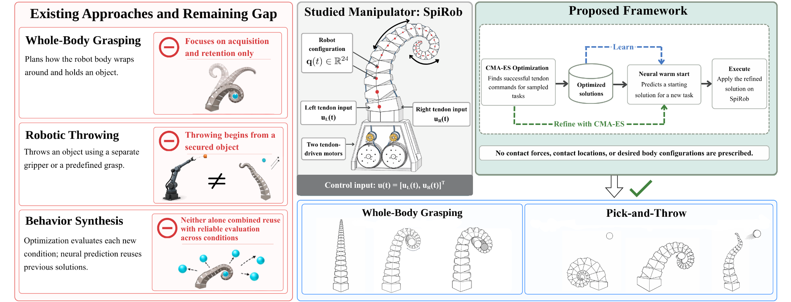
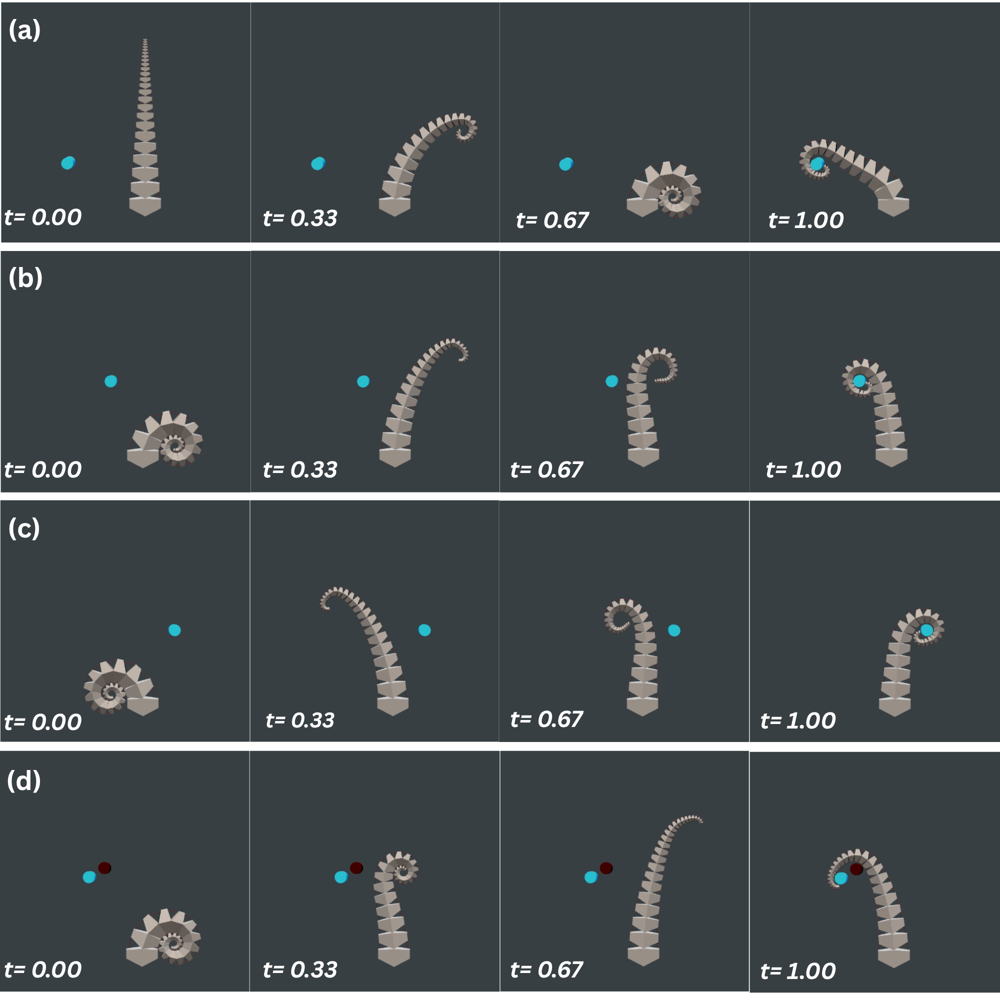
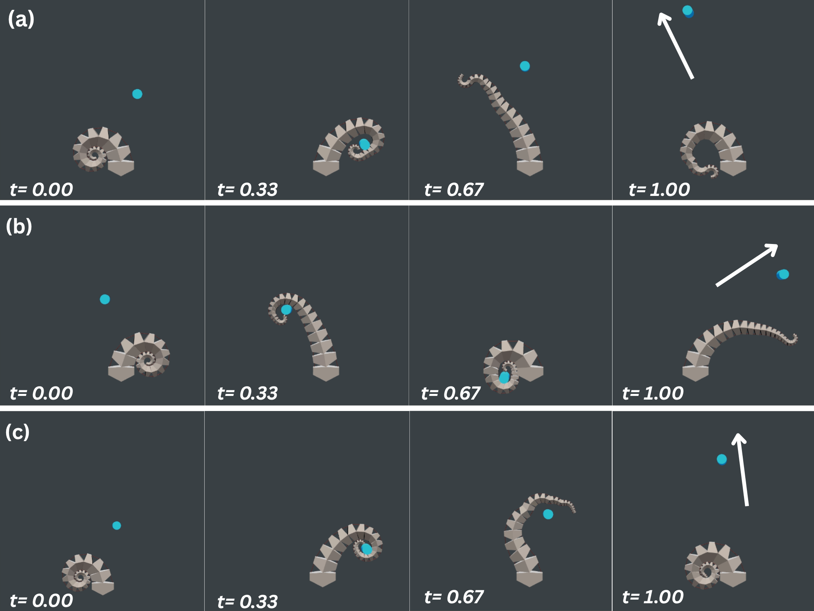
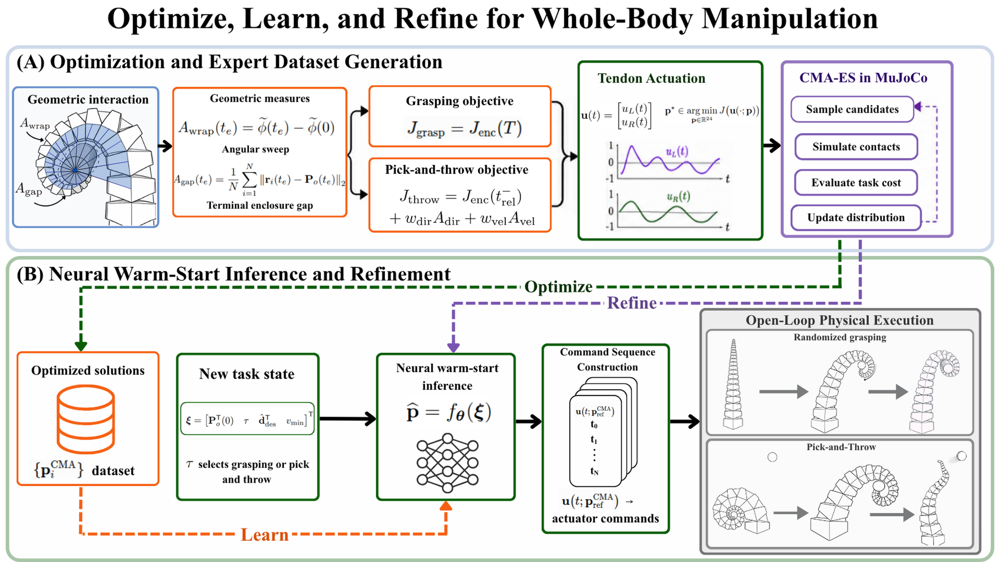

# SpiRob — Spiral Soft Robot for Whole-Body Manipulation

Simulation and optimization code for **SpiRob**, a tendon-driven, spiral-inspired soft robotic manipulator, exploring **whole-body grasping** and **pick-and-throw** from initially ungrasped object configurations.

The central research direction is outcome-based actuation planning: instead of prescribing every intermediate configuration or contact location, the controller searches for tendon command trajectories that produce useful object-level behavior in MuJoCo.

## Overview



SpiRob's two tendon inputs deform a progressively scaled spiral body. The project investigates planning across contact-rich behaviors using CMA-ES and a learned initialization for subsequent optimization.

## Demonstrated behaviors

### Whole-body grasping



Examples of whole-body wrapping and object enclosure from different initial conditions.

### Pick-and-throw



Illustrative sequences for object acquisition, contact-mediated manipulation, and release. The separate exploratory throwing script uses a simulated friction adjustment during release.

## Methodology



The main `spirob_pipeline.py` implements a **CMA-ES → expert data → neural warm start → CMA-ES refinement** workflow:

1. **Optimize:** evaluate tendon command candidates in MuJoCo against a task-specific outcome cost.
2. **Learn:** train a predictor on optimized coefficient vectors for sampled task conditions.
3. **Refine:** initialize CMA-ES from a neural prediction and search again for the new condition.
4. **Replay:** inspect and validate saved episodes using the same simulation model and settings.

The current main pipeline uses a 24-parameter command representation and task-level open-loop execution. A neural initializer does **not** replace simulation-based refinement.

## Repository structure

```text
SpiRob-GitHub/
├── README.md
├── .gitignore
├── requirements.txt
├── spirob_pipeline.py             # Main optimize / collect / train / refine / replay CLI
├── SpiRob.xml                     # Main MuJoCo scene
├── SpiRob_obstacle.xml            # Obstacle scene
├── model/
│   ├── P24.STL                   # Required mesh for both scenes
│   └── README.md                  # Geometry asset notes
├── figures/
│   ├── overview.png
│   ├── methodology.png
│   ├── grasping.png
│   └── pick-and-throw.png
├── experiments/
│   ├── obstacle_grasping.py       # Obstacle and mirrored-grasp exploration
│   ├── throwing_experiments.py    # Multi-direction / speed throwing exploration
│   └── replay_analysis.py         # Saved-control replay, diagnostics, plots, optional video
└── outputs/                       # Generated data (ignored by Git)
```

## Installation

Requires Python 3.10+ (suggested). From the repository root:

```bash
python -m venv .venv
source .venv/bin/activate           # Windows: .venv\Scripts\activate
python -m pip install -r requirements.txt
```

For a quick check of Python command-generation invariants (without loading the scene), run:

```bash
python spirob_pipeline.py self-test
```

## Main workflow

```bash
# Optimize a grasp for one object center (x, z):
python spirob_pipeline.py optimize --goal 0.1931 0.6790 --out outputs/grasp_episode.npz

# Generate a SMALL example dataset (full collection can be costly):
python spirob_pipeline.py collect --limit 4 --iters 5 --out outputs/experts.npz

# Train neural initialization on saved expert parameters:
python spirob_pipeline.py train --data outputs/experts.npz --out outputs/warm_start.npz

# Refine an inferred starting point for a new goal:
python spirob_pipeline.py refine --weights outputs/warm_start.npz --goal 0.1963 0.6327 --out outputs/refined_episode.npz

# Replay the saved episode (checks compatible metadata):
python spirob_pipeline.py replay --episode outputs/refined_episode.npz
```

These commands illustrate the interface; small optimization budgets and tiny datasets **do not establish performance or generalization**. Add `--show` for an interactive viewer when a graphical desktop is available. See `python spirob_pipeline.py --help` for optimization settings, throwing conditions, and parallel-worker controls.

## Additional experiments

The `experiments/` directory contains earlier, distinct exploratory implementations:

- `obstacle_grasping.py`: object placement, deterministic obstacle placement, CMA-ES-based right-side control, and mirrored left-side replay using `SpiRob_obstacle.xml`. It writes control traces and episode summaries to `outputs/obstacles/`.
- `throwing_experiments.py`: fixed-object-position, multi-direction / multi-speed throwing trials using separately optimized release parameters. It writes traces and summaries to `outputs/throwing/`.
- `replay_analysis.py`: consumes saved controls **and a compatible summary JSON** from the older experiment format, and creates plots/snapshots (optional videos). Example after generating obstacle output:

```bash
python experiments/obstacle_grasping.py
python experiments/replay_analysis.py --save-dir outputs/obstacles --no-view
```

The scripts assume MuJoCo graphics support for interactive viewers/video; a headless environment may require additional configuration.

## License and asset rights

The repository code is proposed for release under the [MIT License](LICENSE), **subject to verification of ownership and authorization for all contributors**. The `LICENSE` currently uses a provisional copyright attribution; update this before publishing. Research figures and geometry are **not covered by the MIT grant**; see [ASSET_RIGHTS.md](ASSET_RIGHTS.md).

## Maintainers and contributions

For research collaborations, questions, or reuse, open a GitHub issue after the repository is published. Contributions and pull requests should document the simulation asset version, task settings, random seeds, command traces, and evaluation metrics.
